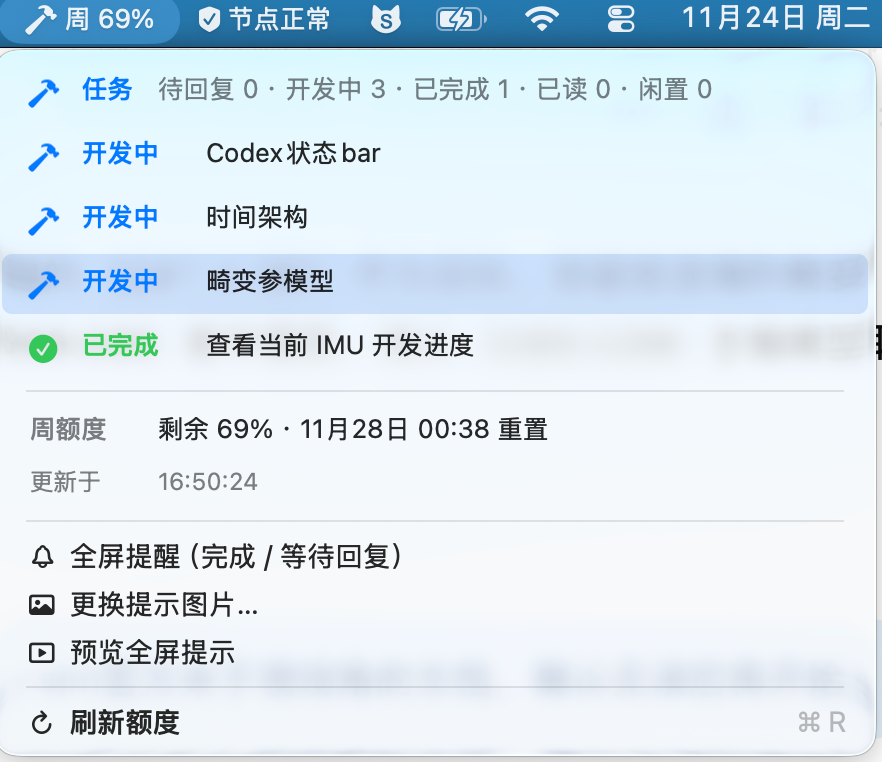
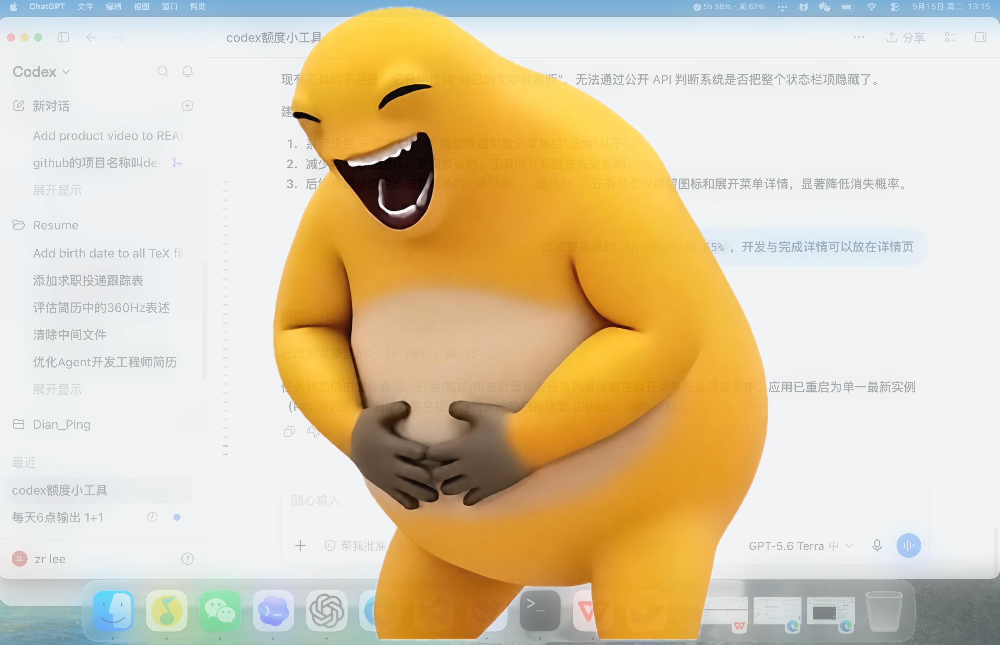

# Codex Status Bar

[中文](README.md)

A macOS menu bar utility for keeping track of Codex chats. See your weekly quota at a glance and open the menu to find tasks that are running, waiting for you, or ready to read.



## Install

Requires macOS 13 or later, the Codex desktop app or CLI, and the macOS Command Line Tools (`xcode-select --install`).

```bash
git clone https://github.com/Universeeeeeee/codex-status-bar.git
cd codex-status-bar
make run
```

The build produces `outputs/Codex Status.app`. Move it to Applications for regular use. To launch it at login, add it in System Settings → General → Login Items & Extensions.

## Use

- **Check tasks and quota.** Hover over the status item for about 0.3 seconds or click it to open the menu. A menu opened by hovering closes when you move away from both the item and the menu. Press `⌘R` to refresh the quota.
- **Open a chat.** With the Codex desktop app installed, click anywhere in a task row to open its local conversation.
- **Get full-screen alerts.** Enable alerts when a task completes or asks for input. You can choose a GIF or still image and preview the alert from the menu.



## Task states

| State | Meaning |
| --- | --- |
| Waiting for input | Codex is waiting for your reply. |
| Working | The current turn is running. |
| Completed | The turn finished and no read receipt has been detected. |
| Read | A read receipt was detected for the result. This state lasts up to 10 minutes. |
| Idle | The chat has no active or waiting task. It returns to Idle after the Read state expires. |

Unread results stay in the menu. Read and idle tasks disappear once more than two hours have passed since their last activity.

## Local development

Run `make test` for tests, `make app` to build the app, or `make archive` to package a ZIP. The app reads session activity locally and gets quota data from the local Codex app-server.

[MIT](LICENSE)
