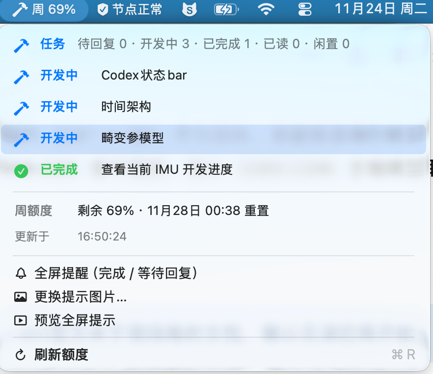
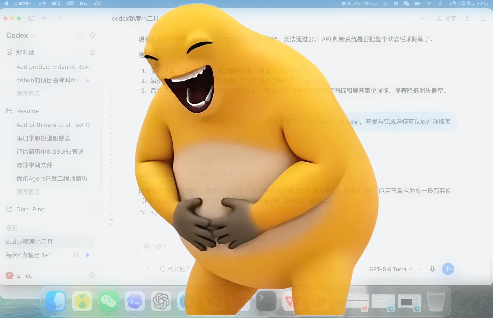

# Codex Status Bar

[English](README.en.md)

一个 macOS 菜单栏小工具。并行跑多个 Codex 对话时，抬眼就能看到周额度，展开菜单就能找到正在运行、等你回复或已有结果的任务。



## 安装

需要 macOS 13 或更高版本、Codex 桌面端或 CLI，以及 macOS 命令行工具（`xcode-select --install`）。

```bash
git clone https://github.com/Universeeeeeee/codex-status-bar.git
cd codex-status-bar
make run
```

应用生成在 `outputs/Codex Status.app`。可拖到「应用程序」文件夹。需要登录时自动启动，可在「系统设置 → 通用 → 登录项与扩展」中添加它。

## 使用

- **查看任务和额度**。鼠标悬停约 0.3 秒或点击状态项展开菜单。光标移出状态项和菜单后，悬停打开的菜单会自动收起。按 `⌘R` 可刷新额度。
- **打开对话**。安装 Codex 桌面端后，点击任务行任意位置即可跳转到对应的本地对话。
- **全屏提醒**。任务完成或需要回复时可弹出提醒。菜单里可以开关提醒、换成 GIF 或静态图片，也可以预览。



## 任务状态

| 状态 | 含义 |
| --- | --- |
| 等待回复 | Codex 正在等你输入。 |
| 开发中 | 当前回合正在运行。 |
| 已完成 | 当前回合已完成，结果尚未检测到已读。 |
| 已读 | 检测到本次结果已读，最多显示 10 分钟。 |
| 闲置 | 当前没有任务运行或等待回复。已读提示结束后会进入此状态。 |

未读的完成任务会保留。距最后一次活动超过 2 小时后，已读和闲置任务从菜单移除。

## 本地开发

运行 `make test` 执行测试，`make app` 构建应用，`make archive` 打包 ZIP。应用在本机读取会话状态，并通过本机 Codex app-server 获取额度。

[MIT](LICENSE)
